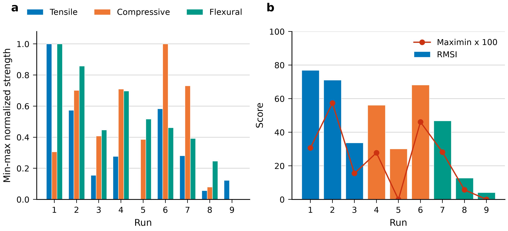
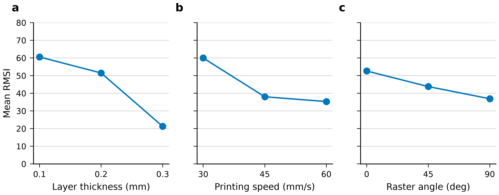

# Results

The nine unreplicated runs do not place the three strengths on comparable intervals. The flexural range is 56.80 MPa, versus 24.50 MPa in tension and 23.80 MPa in compression. Flexural strength extends from 30.00 MPa to 86.80 MPa, tensile strength extends from 16.70 MPa to 41.20 MPa, and compressive strength extends from 45.90 MPa to 69.70 MPa. Table 3 sets those ranges beside the mean and the sample standard deviation of each column. The tensile mean is 25.01 MPa and the tensile sample standard deviation is 7.91 MPa. The compressive mean is 57.33 MPa and the compressive sample standard deviation is 7.85 MPa. The flexural mean is 59.16 MPa and the flexural sample standard deviation is 17.34 MPa. The sample standard deviation uses the n−1 divisor and describes the nine runs in Table 2. Each run contributes one tensile value, one compressive value, and one flexural value, so the dispersion is the scatter among the nine process combinations rather than the repeatability of a single coupon. A normalized step of a given size covers a longer megapascal distance in flexure than in tension or in compression, because the flexural interval is the long one. The tensile range and the compressive range stay close to one another, at 24.50 MPa and 23.80 MPa, while the compressive observations occupy the higher band of absolute strength. The index that follows is built from the position of each observation inside its own column, so the wider flexural interval does not set the scale for tension or compression.

Table 3. Cross-run minimum, maximum, range, mean, and sample standard deviation of the three strengths, using the n−1 divisor across the nine runs.

| Response | Minimum (MPa) | Maximum (MPa) | Range (MPa) | Mean (MPa) | Sample standard deviation (MPa) |
|---|---:|---:|---:|---:|---:|
| Tensile | 16.70 | 41.20 | 24.50 | 25.01 | 7.91 |
| Compressive | 45.90 | 69.70 | 23.80 | 57.33 | 7.85 |
| Flexural | 30.00 | 86.80 | 56.80 | 59.16 | 17.34 |

Normalization uses the observed minimum and maximum of each column, so the weakest observation in a column scores 0.000 and the strongest scores 1.000. Run 1 was printed at a layer thickness of 0.1 mm, a printing speed of 30 mm/s, and a raster angle of 0°. That run holds the tensile strength of 41.20 MPa and the flexural strength of 86.80 MPa. Run 1 normalized scores are 1.000, 0.307, and 1.000, and the RMSI of Run 1 is 76.89. The compressive strength attached to the middle score is 53.20 MPa, so a run that leads two columns still sits at 0.307 of the compressive range. Run 9 was printed at 0.3 mm, 60 mm/s, and 45°. It holds the compressive strength of 45.90 MPa and the flexural strength of 30.00 MPa, and its compressive and flexural normalized scores are 0.000 and 0.000. Its tensile strength is 19.70 MPa, which corresponds to a normalized tensile score of 0.122. Run 9 has an RMSI of 4.08. No specification limit was supplied with the nine strengths, so the position of Run 9 is the bottom of the compressive and flexural ranges actually observed in this array. Every remaining run is placed on the same within-column scale. A normalized score reports where the observation sits between the minimum and the maximum of its own column. The equal-weight combination of the three scores is the RMSI.

The RMSI used for the ranking is the equal-weight combination of the three normalized scores. The RMSI order is Run 1, Run 2, Run 6, Run 4, Run 7, Run 3, Run 5, Run 8, Run 9. The RMSI values in that order are 76.89, 71.08, 68.16, 56.16, 46.84, 33.66, 30.14, 12.78, and 4.08. Run 2, printed at 0.1 mm, 45 mm/s, and 45°, has normalized scores of 0.573, 0.702, and 0.857, and its RMSI is 71.08. Run 6, printed at 0.2 mm, 60 mm/s, and 0°, has normalized scores of 0.584, 1.000, and 0.461, and its RMSI is 68.16. The next two positions belong to runs whose scores are uneven. Run 4, at 0.2 mm, 30 mm/s, and 45°, reaches an RMSI of 56.16 from normalized scores of 0.278, 0.710, and 0.697. Run 7, at 0.3 mm, 30 mm/s, and 90°, reaches an RMSI of 46.84 from normalized scores of 0.282, 0.731, and 0.393. Farther down the order, Run 3 reaches 33.66 from scores of 0.155, 0.408, and 0.447, Run 5 reaches 30.14 from scores of 0.000, 0.387, and 0.518, and Run 8 reaches 12.78 from scores of 0.057, 0.080, and 0.246, before Run 9 closes the list at 4.08. Figure 1 shows the run scores, with the normalized components and the RMSI on the same run axis. The sequence describes these nine observations, and the reported RMSI values run from 76.89 at Run 1 to 4.08 at Run 9.

A second rule retains only the lowest normalized score of each run. The maximin order starts with Run 2 (0.573), Run 6 (0.461), and Run 1 (0.307), and it continues with Run 7 (0.282), Run 4 (0.278), Run 3 (0.155), and Run 8 (0.057). Runs 5 and 9 have maximin 0. On Run 5 the floor is tension. That run records the tensile minimum of 16.70 MPa, so its normalized tensile score is 0.000, while its compressive and flexural strengths are 55.10 MPa and 59.40 MPa, with normalized scores of 0.387 and 0.518. Its RMSI is 30.14. In the equal-weight order that value places Run 5 seventh, while the worst-case score ties Run 5 with Run 9. On Run 9 the floor is shared by compression and flexure, both at 0.000, and the tensile score of 0.122 does not raise the maximin. Figure 1 shows the two rankings on the same nine runs. The run with the highest RMSI is third when the weakest score decides. Run 6 stays in both lists, third by RMSI at 68.16 and second by maximin at 0.461. Leaving Run 6 out would make the disagreement look like a simple exchange of Run 1 and Run 2, and it would hide the run that leads the compressive column while remaining ahead of Run 1 on the worst-case score.

The compressive column is where the two rankings separate. Run 1 records a compressive strength of 53.20 MPa. In a column whose minimum is 45.90 MPa and whose maximum is 69.70 MPa, that observation is the source of the normalized score 0.307, and 0.307 is also the maximin of Run 1. Run 6 compressive strength is 69.70 MPa, the maximum of the compressive column, so the compressive normalized score on that row is 1.000. Run 6 also records a tensile strength of 31.00 MPa and a flexural strength of 56.20 MPa, which normalize to 0.584 and 0.461. The weakest of those three scores is the flexural score 0.461, and that score still lies above the compressive score of Run 1. Run 2 records 30.75 MPa in tension, 62.60 MPa in compression, and 78.70 MPa in flexure. None of the three is a column maximum, but the lowest normalized score on the row is 0.573, which is above both 0.461 and 0.307. The nine rows do not identify a duty cycle in which tension, compression, or flexure should count more than the others, and no extra weighting is applied. Under equal weights, Run 1 stands at the head of the list. Under the maximin rule, Run 2 stands at the head of the list and Run 6 remains ahead of Run 1. Table 4 places the raw strengths, the normalized scores, the RMSI, and the maximin value on one row for each run, so the two readings can be checked against the same observations.

Table 4. Normalized tensile, compressive, and flexural scores, the equal-weight RMSI, and the maximin score for each run. Strengths are in MPa, and each strength was observed once.

| Run | Layer (mm) | Speed (mm/s) | Raster (°) | Tensile | Compressive | Flexural | nT | nC | nF | RMSI | Maximin |
|---|---:|---:|---:|---:|---:|---:|---:|---:|---:|---:|---:|
| 1 | 0.1 | 30 | 0 | 41.20 | 53.20 | 86.80 | 1.000 | 0.307 | 1.000 | 76.89 | 0.307 |
| 2 | 0.1 | 45 | 45 | 30.75 | 62.60 | 78.70 | 0.573 | 0.702 | 0.857 | 71.08 | 0.573 |
| 3 | 0.1 | 60 | 90 | 20.50 | 55.60 | 55.40 | 0.155 | 0.408 | 0.447 | 33.66 | 0.155 |
| 4 | 0.2 | 30 | 45 | 23.50 | 62.80 | 69.60 | 0.278 | 0.710 | 0.697 | 56.16 | 0.278 |
| 5 | 0.2 | 45 | 90 | 16.70 | 55.10 | 59.40 | 0.000 | 0.387 | 0.518 | 30.14 | 0.000 |
| 6 | 0.2 | 60 | 0 | 31.00 | 69.70 | 56.20 | 0.584 | 1.000 | 0.461 | 68.16 | 0.461 |
| 7 | 0.3 | 30 | 90 | 23.60 | 63.30 | 52.30 | 0.282 | 0.731 | 0.393 | 46.84 | 0.282 |
| 8 | 0.3 | 45 | 0 | 18.10 | 47.80 | 44.00 | 0.057 | 0.080 | 0.246 | 12.78 | 0.057 |
| 9 | 0.3 | 60 | 45 | 19.70 | 45.90 | 30.00 | 0.122 | 0.000 | 0.000 | 4.08 | 0.000 |

Figure 2 shows the level means of RMSI, and Table 5 lists those means beside the mean tensile, compressive, and flexural strengths. The layer-thickness RMSI means are 60.55 at 0.1 mm, 51.49 at 0.2 mm, and 21.24 at 0.3 mm. The spread given for these layer-thickness means is 39.31. The printing-speed RMSI means are 59.97 at 30 mm/s, 38.00 at 45 mm/s, and 35.30 at 60 mm/s. The spread given for these speed means is 24.66. The raster-angle RMSI means are 52.61 at 0°, 43.78 at 45°, and 36.88 at 90°. The spread given for these raster means is 15.73. Inside this array, the layer-thickness means of RMSI lie farther apart than the speed means, and the speed means lie farther apart than the raster means. Compressive strength does not follow the layer-thickness order of the index. Compressive level means are highest at 0.2 mm (62.53 MPa), not at 0.1 mm (57.13 MPa), and the compressive mean at 0.3 mm is 52.33 MPa. Across raster angle the compressive level means are nearly flat, at 56.90 MPa, 57.10 MPa, and 58.00 MPa. Tensile speed means are not monotone. They are 29.43 MPa at 30 mm/s, 21.85 MPa at 45 mm/s, and 23.73 MPa at 60 mm/s. Flexural means move with the RMSI means, falling as each factor increases: 73.63 MPa, 61.73 MPa, and 42.10 MPa for layer thickness; 69.57 MPa, 60.70 MPa, and 47.20 MPa for printing speed; and 62.33 MPa, 59.43 MPa, and 55.70 MPa for raster angle. Tensile means by layer thickness are 30.82 MPa, 23.73 MPa, and 20.47 MPa, and tensile means by raster angle are 30.10 MPa, 24.65 MPa, and 20.27 MPa. Compressive means by printing speed are 59.77 MPa, 55.17 MPa, and 57.07 MPa, so the speed pattern in compression is uneven as well. Each mean averages the three runs that carry the named level while the other two factors change.

Table 5. Descriptive level means of RMSI and of the three strengths. Each cell averages the three runs at that level, while the other two factors change.

| Factor | Level | Mean RMSI | Mean tensile (MPa) | Mean compressive (MPa) | Mean flexural (MPa) |
|---|---|---:|---:|---:|---:|
| Layer thickness | 0.1 mm | 60.55 | 30.82 | 57.13 | 73.63 |
| Layer thickness | 0.2 mm | 51.49 | 23.73 | 62.53 | 61.73 |
| Layer thickness | 0.3 mm | 21.24 | 20.47 | 52.33 | 42.10 |
| Printing speed | 30 mm/s | 59.97 | 29.43 | 59.77 | 69.57 |
| Printing speed | 45 mm/s | 38.00 | 21.85 | 55.17 | 60.70 |
| Printing speed | 60 mm/s | 35.30 | 23.73 | 57.07 | 47.20 |
| Raster angle | 0° | 52.61 | 30.10 | 56.90 | 62.33 |
| Raster angle | 45° | 43.78 | 24.65 | 57.10 | 59.43 |
| Raster angle | 90° | 36.88 | 20.27 | 58.00 | 55.70 |

These level means are descriptive averages of three single observations. In the L9 layout every layer thickness, every printing speed, and every raster angle appears in three runs, but the other two factors change from run to run, so the three observations behind a mean are not repeat tests of one setting. No second measurement of the same combination was supplied, and the averages in Table 5 and Figure 2 are not compared with a pure-error term. The nine rows support the equal-weight order from Run 1 at an RMSI of 76.89 to Run 9 at an RMSI of 4.08, and they support the maximin order that starts with Run 2 (0.573), Run 6 (0.461), and Run 1 (0.307), with Runs 5 and 9 at maximin 0. They do not separate a factor from the companions that travel with it in the array. The normalized scores are tied to the minima and maxima of these nine runs, and a print that fell outside the present ranges would require every score to be rebuilt. No confirmation run is present in the record. Table 2 contains the measured strengths, Table 3 contains their dispersion, Table 4 contains the normalized scores, the RMSI, and the maximin values, Table 5 contains the level means, Figure 1 shows the run scores, and Figure 2 shows the level means of RMSI. That collection is the numerical decision this screen can carry.
