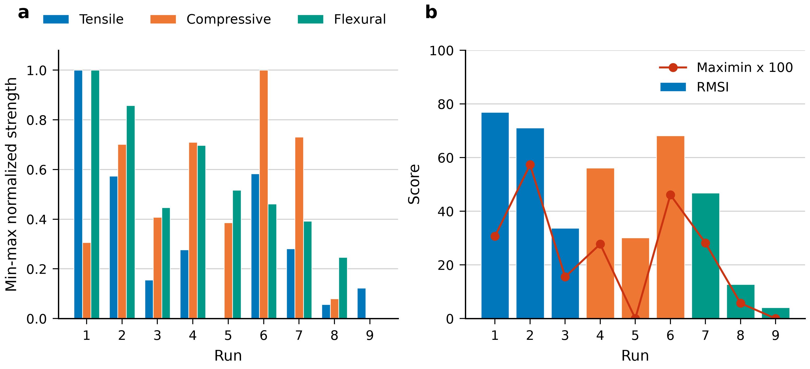
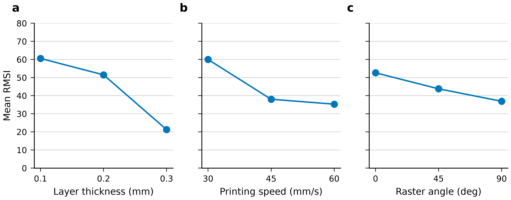

# A Relative Multimode Strength Index for Screening Fused-Filament Parameters of Short-Carbon-Fiber PLA

Running title: RMSI screening of short-carbon-fiber PLA

Target journal: Polymer(Korea)

## Abstract

Short-carbon-fiber polylactic acid printed by fused filament fabrication can be loaded in tension, compression, and flexure, and a setting chosen for one strength can be weak in another. Nine Taguchi runs varied layer thickness, printing speed, and raster angle, with one tensile, compressive, and flexural strength recorded for each run. The Relative Multimode Strength Index min-max normalizes those strengths and averages them with equal weight on a 0–100 scale. The index is 76.89 for the run at 0.1 mm, 30 mm/s, and 0°, and 4.08 for the run at 0.3 mm, 60 mm/s, and 45°. A maximin reading of the same normalized scores ranks the second run first, because the leading average is relatively weak in compression. The index screens lightweight prototype settings inside this data set only, and it is not a significance test.

Keywords: Relative Multimode Strength Index; Taguchi L9 orthogonal array; short-carbon-fiber PLA; fused filament fabrication; lightweight prototype screening

## Introduction

Polymer parts that must carry load are already produced by fused filament fabrication, yet the bond between one deposited layer and the next still limits mechanical reliability. Omer and colleagues review that bond for fused deposition modelling, the material-extrusion route this article refers to as fused filament fabrication. They treat bond quality as a constraint that continues to govern both polymer parts and composite parts: a weak interface increases anisotropy, and actions taken before printing, during the build, or after the build each leave some of the constraint in place (Omer et al., 2025)1. Under that constraint, tension is only a partial description of the solid. A road may resist a pull directed along its length and still open when the load pries successive layers apart, so a ranking obtained in tension does not stand in for a second mode. Numerical prediction does not make the ranking portable. Enriconi and colleagues, reviewing models of fused filament fabrication, find structural reliability difficult to forecast once the filament contains fiber, because the filler can point in different directions and because adhesion from layer to layer changes the response a model has to match (Enriconi et al., 2025)2. A strength measured on one PLA printer, or on one short-carbon-fiber PLA printer, stays with that printer, that toolpath, and that test. The layout reported here records neither the width of the bond, nor the porosity of the part, nor the temperature history along a road. The interface limit, and the weak portability of predictions for fiber-filled filaments, are the reasons for judging one commercial short-carbon-fiber PLA in tension, compression, and flexure inside a single screen.

Layer thickness and raster angle earn a place in that screen because both have already changed measured strength, while the size of the change has to remain attached to the test that produced it. On fused-filament PLA, Gajjar and colleagues tracked tensile strength through four adjustments. Thinning the layers from 0.4 mm to 0.2 mm raised strength by as much as 12%. Moving the raster from 90° toward 0° raised it by as much as 40%. Heating the nozzle from 200 °C to 220 °C added up to 10%, and slowing the feed from 60 mm/s to 40 mm/s added up to 7% (Gajjar et al., 2025)3. All four of those gains belong to the PLA series at the levels named above. The present screen prints a short-carbon-fiber filament, uses another set of levels, and keeps three strength columns, so the percentages are not expected increments for these runs. Short-carbon-fiber PLA has its own layer-height evidence, and that evidence is tied to particular properties. Alkabbanie and colleagues associate a layer height of 0.1 mm with a 28.05% rise covering flexural strength and impact strength. In the same prints the fibers worsened the microstructure, increased crystallinity, and failed to move every mechanical result in one direction. A higher extrusion temperature raised impact strength and simultaneously lowered flexural strength (Alkabbanie et al., 2024)4. Layer height is a reasonable factor to vary once the filament contains short carbon fiber. A flexural or impact gain, the 28.05% figure included, is not a prediction of how tension or compression will move in the nine runs of this article.

Carbon fiber does not raise every strength, and the published direction of the change depends on the property, the fiber content, and the control that was printed. The contrasts that follow come from other filaments and other designs. The nine runs contain no neat-PLA control, so they support no statement that the commercial filament is stronger than neat PLA, and the external numbers are not a yardstick for those runs. In a honeycomb-infill series, Rogelj and colleagues stepped infill from 40% to 100%. At 40% infill the carbon-fiber PLA measured 17.75 MPa in tension, and at 100% infill it measured 28.72 MPa. Neat PLA at those same infill steps measured 30.75 MPa and 49.11 MPa, so the filled grade stayed below the neat polymer in that tensile comparison. Reducing layer height from 0.40 mm to 0.20 mm added 3.1% to the tensile strength of the filled grade (Rogelj et al., 2025)5. Changing composition splits tension from flexure more directly. Blake and colleagues increased the carbon-fiber fraction in PLA and observed tensile strength rising as flexural strength fell, with contents between the extremes presented as a compromise between the two responses (Blake et al., 2025)7. A matched flexural test can point the other way. In an ASTM three-point bend, Keshavamurthy and colleagues found an 88% flexural advantage for fused-deposition PLA containing 6 wt% short carbon fiber over unreinforced PLA printed under matched conditions, and their 3 wt% material also carried a larger load than the unreinforced polymer (Keshavamurthy et al., 2026)8. Raising the fiber content further can undo a gain when the fibers clump. Among the PLA composites made by Gök and Akay, tension was greatest at 17.47 MPa for the compound that contained 3% glass fiber, and a loading of 5% fiber lowered performance, an effect they attribute to agglomeration (Gök and Akay, 2025)9. Strength and toughness can part company as well. Alshihabi and colleagues describe PLA-CF as both stronger than neat PLA and more brittle. The ultimate tensile strength of 57.5 MPa in that paper is the figure given for PAHT-CF, so it does not describe PLA-CF (Alshihabi et al., 2025)10. Gök and Akay name lightweight durable parts as a possible use, and Alshihabi and colleagues present their comparison as guidance for parts that should be light, strong, and thermally efficient. That intended use still leaves the mechanical responses free to disagree with one another. No neat-PLA ranking is assigned to the filament printed here.

Infill density and raster orientation are the evidence that fixes the factors in the present screen. Mayandi and colleagues printed chopped carbon-fiber PLA in a design that also changed other settings, and the tensile strengths at 60%, 80%, and 100% infill were 25.9 MPa, 26.9 MPa, and 34.75 MPa. At those same densities the flexural strengths were 11.8 MPa, 12.55 MPa, and 18.4 MPa (Mayandi et al., 2024)11. Both modes responded to density. A comparison whose question is layer thickness, printing speed, and raster angle has to keep density at one value, or an infill shift will be mixed into the three factors under study. The L9 used here does so. Raster angle remains because, in PLA+, orientation has altered tension and flexure inside one experiment. Ramírez-Prieto and colleagues obtained both their highest tensile strength and their highest flexural strength from a 0°/0° raster. The 45°/−45° raster was their weakest pattern in flexure and the more ductile of the patterns they printed (Ramírez-Prieto et al., 2025)6. Raster angle is a credible factor when more than one mode is of interest. Compression is absent from that PLA+ experiment, so the compressive column in the present record has no source there. The paired 0°/0° instruction is also a different toolpath from the single 0° level that appears in this L9. The screen changes layer thickness, printing speed, and one raster angle, holds infill constant, and measures compression together with tension and flexure.

Even a campaign that already measures several mechanical responses, or that already fuses them into one grade, still selects a preferred setting according to which response is inspected and which rule performs the fusion. Verim and colleagues ran a Taguchi experiment on PLA with five specimens at each design point and recorded tension, compression, flexure, impact, hardness, and roughness. Infill density accounted for 55.21% of the tensile variation and for 80.86% of the compressive variation. In flexure that share was 25.66% and stood second in their ranking, while printing speed and raster angle placed below infill density and below wall thickness (Verim et al., 2025)12. Those shares describe PLA in a design that allowed infill to vary. They show that factor order is not common to every mechanical test, and that infill can dominate tension and compression when it is free. Because the present short-carbon-fiber layout holds infill fixed, it needs its own factor comparison and does not take over the PLA order. Disagreement among properties is visible inside an L9 before any grade is computed. Mohsein and colleagues treated tension, flexure, and Shore D hardness as joint outputs of an L9 on fused-deposition PLA. Layer thickness was the main factor in the two strength tests, infill was the main factor in hardness, and raster angle contributed little. On the Pareto front, tension preferred the low-infill side and flexure and hardness preferred the high-infill side. The authors note the statistical limits of their screening design and treat the flexure and hardness series as awaiting replication (Mohsein et al., 2026)13. An unreplicated L9 can display a conflict. It does not confirm a setting.

The selected point can move again once separate responses are fused by an explicit rule. For fused-deposition PLA, Patel and colleagues report three L9 preferences that do not match: tension was best at 70 mm/s with layers of 0.2 mm and infill of 40%; hardness was best at 60 mm/s with layers of 0.3 mm and infill of 40%; grey-relational aggregation was best at 70 mm/s with layers of 0.3 mm and infill of 40% (Patel et al., 2024)14. The aggregated grade kept a different layer thickness from the thickness preferred by tension. Grey relational analysis is a coherent way to construct that grade, and the grade can still select a different setting from any single response. The same dependence on the combining rule appears in carbon-fiber polyamide. Almuflih and colleagues built one grey relational grade for PA12-CF from surface roughness together with the tensile and flexural results. A later optimizer reported roughness of 4.63 μm, tensile strength of 88.5 MPa, and flexural strength of 103.12 MPa. Layer thickness, the infill used in that study, and build orientation each influenced the grade (Almuflih et al., 2024)15. The three optimized figures belong to PA12-CF under that procedure. They are not acceptance values for the short-carbon-fiber PLA runs. An index that gives the three modes equal weight, placed next to a score that keeps only the worst of the normalized modes, leaves this dependence open to inspection.

What is still missing is a score for short-carbon-fiber PLA that rescales tensile strength, compressive strength, and flexural strength by the minimum and the maximum of each column, averages the three rescaled values at equal weight, and is set beside a maximin score, all from one L9 that was not replicated. Mohsein and colleagues supply the replication caution that belongs with that design: their L9 could separate conflicting preferences in PLA, and they still class the screen as provisional until the tests are repeated (Mohsein et al., 2026)13. The material was PLA rather than short-carbon-fiber PLA, and hardness stood in the third column, so the caution is about what an unreplicated layout can decide. It is not a transfer of their property values onto PLA-CF. Weighting studies that do use carbon-fiber PLA are aimed at flexure rather than at the three strengths named above. Linul and colleagues optimized eight responses, every one of them flexural, on carbon-fiber PLA produced by additive manufacturing. In that flexural optimization, the dominant factors were printing temperature, layer thickness, and outer shells, while printing speed contributed less. Desirability was 0.9899 with GWO-MEREC-DFA weights, 0.9756 with GWO-CRITIC-DFA weights, and 0.9751 when the weights were equal (Linul et al., 2026)16. The equal-weight desirability lies near the other two and is not identical to them. Equal weight, on that result, is a convention the analyst writes down. It is not a balance read off the mechanics of the coupon, and the data behind it contain neither a tensile column nor a compressive column. The normalization has to be named for a separate reason. Comparing decision procedures on sustainability scores for an aircraft component, Malefaki and colleagues found that a change of method, a change of normalization, and a change of weights each shifted the combined index (Malefaki et al., 2025)17. The case is not a fused-filament data set. The comparison still requires any min-max score to be read only inside the observations that set its lower bounds, its upper bounds, and its weights. For the nine PLA-CF runs, the equal-weight score can order the runs by average relative standing, and the maximin score, equal to the smallest of the three normalized strengths, can order them by the mode in which they are relatively weakest. The two orders serve different screening questions. Neither order selects a setting for a service load, a geometry, or a filament outside the nine runs, and neither order converts the L9 from a screen into a confirmed process window.

This article performs that calculation for one commercial short-carbon-fiber PLA, Bambu Lab PLA-CF, with the nozzle at 220 °C and the bed at 55 °C. Infill density is kept at a single setting. Layer thickness, printing speed, and raster angle are varied in an unreplicated Taguchi L9. The thickness levels are 0.1 mm, 0.2 mm, and 0.3 mm. The speed levels are 30 mm/s, 45 mm/s, and 60 mm/s. The raster levels are 0°, 45°, and 90°, and each level is one angle rather than a pair of alternating angles. Every run contributes one tensile strength under ASTM D638, one compressive strength under ASTM D695, and one flexural strength under ASTM D790. Each of those cells contains a single observation. Inside a strength column, the lowest value is mapped to zero and the highest value to one by subtracting the column minimum and dividing by the column range. The Relative Multimode Strength Index is one hundred times the arithmetic mean of the three mapped values, with each value given the same weight. For any run, the maximin score retains whichever mapped value is the smallest of the three. The nine runs are ordered by the index and ordered again by the maximin score. After this scaling, a larger index is a better average position across the three modes, and a larger maximin score is a less severe weakest mode. Both scores are devices for screening prototype settings of lightweight parts, and both are confined to the nine runs that fix their minima, their maxima, and their equal weights. One observation in each cell provides no replicate error with which to test a difference among levels, and neither score qualifies a part for a duty the screen did not impose.

## Experimental

The filament printed for this screen was Bambu Lab PLA-CF, a black polylactic acid grade containing chopped carbon fiber, and every run was produced on a Bambu Lab printer. The nozzle temperature was 220 °C and the bed temperature was 55 °C. The manufacturer-reported melt flow index (MFI) of 3.7 ± 0.6 g/10 min and the density of 1.22 g/cm3 are manufacturer-reported, not measured here. The density is the filament specification supplied by the manufacturer. The record contains no measured part density, no fiber mass fraction, and no fiber length, so the chopped-fiber description is left at the wording supplied with the filament. The nozzle diameter and printer model number were not recorded. Infill density was held constant but the percentage was not recorded, which leaves the infill as a shared setting with no numerical level in the record. The runs change layer thickness, printing speed, and raster angle inside that material and at those two temperatures.

Table 1. Manufacturer-reported filament data and the temperatures used.

| Property | Value | Source |
|---|---|---|
| Filament | Bambu Lab PLA-CF | Material used |
| Description | Black PLA containing chopped carbon fiber | Supplied material description |
| Melt flow index | 3.7 ± 0.6 g/10 min | Manufacturer-reported |
| Density | 1.22 g/cm3 | Manufacturer-reported |
| Nozzle temperature | 220 °C | Temperature used |
| Bed temperature | 55 °C | Temperature used |

The nine runs follow a Taguchi L9 array in layer thickness, printing speed, and raster angle. Layer thickness was set to 0.1, 0.2, or 0.3 mm, printing speed to 30, 45, or 60 mm/s, and raster angle to 0°, 45°, or 90°. The raster angle is the programmed angle and was not separately documented relative to the specimen long axis. The stored value is the angle assigned in the programmed path. The record contains no measured offset between that path and the specimen long axis, so the array does not document whether a programmed 0° followed the specimen long axis or a programmed 90° crossed it. Each level of each factor appears in three runs, and each pairing of levels drawn from two factors appears once. Those nine combinations, and no others, are the rows of Table 2. No combination was repeated, and the plan contains no extra confirmation combination printed after the array. Infill density was held constant but the percentage was not recorded, so the balance among layer thickness, speed, and raster angle is conditional on one unstated infill. What changes from run to run in the recorded plan is the programmed combination at that shared infill.

Each of the nine runs was tested in tension, compression, and flexure. The tensile test was ASTM D638, the compression test was ASTM D695, and the flexure test was ASTM D790. One strength value was recorded for each of the three responses at each of the nine runs. No within-run replicate was available. The table therefore contains twenty-seven strength values, three for each programmed combination, and it contains no repeated measurement of the same response at the same combination. Specimen dimensions, test speed, and support span were not recorded. The ASTM names identify the loading mode of each column. Coupon geometry, crosshead speed, and flexural support span remain unspecified, and no default value is taken from the standards to fill them. The strengths stay in megapascals at the two decimal places in which they were supplied. They are the mechanical responses used for every score below. Table 2 gives the nine-run layout together with the tensile, compressive, and flexural strengths.

Table 2. Nine-run layout and the tensile, compressive, and flexural strengths.

| Run | Layer thickness (mm) | Printing speed (mm/s) | Raster angle (°) | Tensile strength (MPa) | Compressive strength (MPa) | Flexural strength (MPa) |
|---|---:|---:|---:|---:|---:|---:|
| 1 | 0.1 | 30 | 0 | 41.20 | 53.20 | 86.80 |
| 2 | 0.1 | 45 | 45 | 30.75 | 62.60 | 78.70 |
| 3 | 0.1 | 60 | 90 | 20.50 | 55.60 | 55.40 |
| 4 | 0.2 | 30 | 45 | 23.50 | 62.80 | 69.60 |
| 5 | 0.2 | 45 | 90 | 16.70 | 55.10 | 59.40 |
| 6 | 0.2 | 60 | 0 | 31.00 | 69.70 | 56.20 |
| 7 | 0.3 | 30 | 90 | 23.60 | 63.30 | 52.30 |
| 8 | 0.3 | 45 | 0 | 18.10 | 47.80 | 44.00 |
| 9 | 0.3 | 60 | 45 | 19.70 | 45.90 | 30.00 |

The three strengths share the unit MPa, but they do not share a numerical interval. In this table the tensile values lie between 16.70 MPa and 41.20 MPa, a range of 24.50 MPa. The compressive values lie between 45.90 MPa and 69.70 MPa, a range of 23.80 MPa. The flexural values lie between 30.00 MPa and 86.80 MPa, a range of 56.80 MPa. A raw average would treat one megapascal in every column as the same increment, even though the columns begin at different strengths and cover different ranges. Min-max normalization scores each strength against the minimum and the maximum of its own column, so the full observed range of each mode has the same length before the modes are combined.

For run i and response j, the normalized score is the amount by which the recorded strength exceeds the column minimum, divided by the column range. Each of those three ranges is positive, so the divisor is defined for every response. The column minimum scores 0 and the column maximum scores 1. The three normalized scores of a run are then averaged with equal weight and multiplied by 100. The equal-weight screen defined by that average is the Relative Multimode Strength Index (RMSI). The weight on each mode is one third, fixed in the definition of the screen. The same normalized scores supply the maximin score, the lowest of the three. In the equations, i is the run, j is the response, and the names tensile, compressive, and flexural mark the three columns. The normalized score is I_ij = (x_ij − x_j,min) / (x_j,max − x_j,min). The index is RMSI_i = 100 × (I_i,tensile + I_i,compressive + I_i,flexural) / 3. The maximin score is M_i = min(I_i,tensile, I_i,compressive, I_i,flexural).

M_i is the lowest of the tensile, compressive, and flexural normalized scores for that run. The index asks how a run stands when the three modes count equally and a strong mode can offset a weak one. The maximin score asks which run avoids the weakest relative mode, and it lets that weakest normalized score set the rank by itself. The two rules can order the same nine runs differently. That difference comes from the aggregation, and it does not require a further print. The score is read from the normalized values of these nine runs. Because no within-run replicate was available, the lowest normalized score is a single observed position on each column, and no replicate scatter is attached to it. In that sense the maximin score is a screen of the weakest relative mode, read from the nine runs actually tested.

The nine strengths in each column are also summarized by a mean and a sample standard deviation. The mean is the arithmetic mean of the nine recorded values. The sample standard deviation uses n−1 across the nine runs. On that definition the tensile mean is 25.01 MPa and the tensile sample standard deviation is 7.91 MPa, the compressive mean is 57.33 MPa and the compressive sample standard deviation is 7.85 MPa, and the flexural mean is 59.16 MPa and the flexural sample standard deviation is 17.34 MPa. These sample standard deviations describe the spread of the nine runs in the column. They are not measurement uncertainties. They do not describe within-run repeatability, because no within-run replicate was available from which that repeatability could have been calculated. Factor level means are L9 averages. The three runs that share a level of layer thickness, of printing speed, or of raster angle are averaged, once for the index and once for each raw strength. Those three runs are three different combinations that share a level. A level mean averages those three combinations and is distinct from the scatter of repeated prints of one combination. Analysis of variance (ANOVA) is not used, because there is no replicate error. Each level mean stays a description of the three runs that carry that level.

The index can rank only these nine runs. The minima and maxima that set every normalized score are the endpoints of this set, so a new test that extended a column would change the minima and maxima and would change the scores already assigned to the original runs. A further run that fell inside the present ranges would leave those endpoints where they are, yet that additional run is not part of the nine-run screen. The scores belong to the nine rows of Table 2. The maximin score is tied to the same endpoints and moves when an endpoint moves. Mohsein and colleagues treat an L9 that was not repeated as a screen that still awaits confirmation (Mohsein et al., 2026)13. The experiment places one observation at each of the nine combinations and includes no confirmation print, no neat-PLA control, and no second printer. The record also keeps the earlier limits: infill density was held constant but the percentage was not recorded; specimen dimensions, test speed, and support span were not recorded; and the nozzle diameter and printer model number were not recorded. Within that window, the index and the maximin score are two readings of the same nine strengths, and the level means are descriptive averages of the L9 assignment.

## Results

The nine unreplicated runs do not place the three strengths on comparable intervals. The flexural range is 56.80 MPa, versus 24.50 MPa in tension and 23.80 MPa in compression. Flexural strength extends from 30.00 MPa to 86.80 MPa, tensile strength extends from 16.70 MPa to 41.20 MPa, and compressive strength extends from 45.90 MPa to 69.70 MPa. Table 3 sets those ranges beside the mean and the sample standard deviation of each column. The tensile mean is 25.01 MPa and the tensile sample standard deviation is 7.91 MPa. The compressive mean is 57.33 MPa and the compressive sample standard deviation is 7.85 MPa. The flexural mean is 59.16 MPa and the flexural sample standard deviation is 17.34 MPa. The sample standard deviation uses the n−1 divisor and describes the nine runs in Table 2. Each run contributes one tensile value, one compressive value, and one flexural value, so the dispersion is the scatter among the nine process combinations rather than the repeatability of a single coupon. A normalized step of a given size covers a longer megapascal distance in flexure than in tension or in compression, because the flexural interval is the long one. The tensile range and the compressive range stay close to one another, at 24.50 MPa and 23.80 MPa, while the compressive observations occupy the higher band of absolute strength. The index that follows is built from the position of each observation inside its own column, so the wider flexural interval does not set the scale for tension or compression.

Table 3. Cross-run minimum, maximum, range, mean, and sample standard deviation of the three strengths, using the n−1 divisor across the nine runs.

| Response | Minimum (MPa) | Maximum (MPa) | Range (MPa) | Mean (MPa) | Sample standard deviation (MPa) |
|---|---:|---:|---:|---:|---:|
| Tensile | 16.70 | 41.20 | 24.50 | 25.01 | 7.91 |
| Compressive | 45.90 | 69.70 | 23.80 | 57.33 | 7.85 |
| Flexural | 30.00 | 86.80 | 56.80 | 59.16 | 17.34 |

Normalization uses the observed minimum and maximum of each column, so the weakest observation in a column scores 0.000 and the strongest scores 1.000. Run 1 was printed at a layer thickness of 0.1 mm, a printing speed of 30 mm/s, and a raster angle of 0°. That run holds the tensile strength of 41.20 MPa and the flexural strength of 86.80 MPa. Run 1 normalized scores are 1.000, 0.307, and 1.000, and the RMSI of Run 1 is 76.89. The compressive strength attached to the middle score is 53.20 MPa, so a run that leads two columns still sits at 0.307 of the compressive range. Run 9 was printed at 0.3 mm, 60 mm/s, and 45°. It holds the compressive strength of 45.90 MPa and the flexural strength of 30.00 MPa, and its compressive and flexural normalized scores are 0.000 and 0.000. Its tensile strength is 19.70 MPa, which corresponds to a normalized tensile score of 0.122. Run 9 has an RMSI of 4.08. No specification limit was supplied with the nine strengths, so the position of Run 9 is the bottom of the compressive and flexural ranges actually observed in this array. Every remaining run is placed on the same within-column scale. A normalized score reports where the observation sits between the minimum and the maximum of its own column. The equal-weight combination of the three scores is the RMSI.

The RMSI used for the ranking is the equal-weight combination of the three normalized scores. The RMSI order is Run 1, Run 2, Run 6, Run 4, Run 7, Run 3, Run 5, Run 8, Run 9. The RMSI values in that order are 76.89, 71.08, 68.16, 56.16, 46.84, 33.66, 30.14, 12.78, and 4.08. Run 2, printed at 0.1 mm, 45 mm/s, and 45°, has normalized scores of 0.573, 0.702, and 0.857, and its RMSI is 71.08. Run 6, printed at 0.2 mm, 60 mm/s, and 0°, has normalized scores of 0.584, 1.000, and 0.461, and its RMSI is 68.16. The next two positions belong to runs whose scores are uneven. Run 4, at 0.2 mm, 30 mm/s, and 45°, reaches an RMSI of 56.16 from normalized scores of 0.278, 0.710, and 0.697. Run 7, at 0.3 mm, 30 mm/s, and 90°, reaches an RMSI of 46.84 from normalized scores of 0.282, 0.731, and 0.393. Farther down the order, Run 3 reaches 33.66 from scores of 0.155, 0.408, and 0.447, Run 5 reaches 30.14 from scores of 0.000, 0.387, and 0.518, and Run 8 reaches 12.78 from scores of 0.057, 0.080, and 0.246, before Run 9 closes the list at 4.08. Figure 1 shows the run scores, with the normalized components and the RMSI on the same run axis. The sequence describes these nine observations, and the reported RMSI values run from 76.89 at Run 1 to 4.08 at Run 9.

A second rule retains only the lowest normalized score of each run. The maximin order starts with Run 2 (0.573), Run 6 (0.461), and Run 1 (0.307), and it continues with Run 7 (0.282), Run 4 (0.278), Run 3 (0.155), and Run 8 (0.057). Runs 5 and 9 have maximin 0. On Run 5 the floor is tension. That run records the tensile minimum of 16.70 MPa, so its normalized tensile score is 0.000, while its compressive and flexural strengths are 55.10 MPa and 59.40 MPa, with normalized scores of 0.387 and 0.518. Its RMSI is 30.14. In the equal-weight order that value places Run 5 seventh, while the worst-case score ties Run 5 with Run 9. On Run 9 the floor is shared by compression and flexure, both at 0.000, and the tensile score of 0.122 does not raise the maximin. Figure 1 shows the two rankings on the same nine runs. The run with the highest RMSI is third when the weakest score decides. Run 6 stays in both lists, third by RMSI at 68.16 and second by maximin at 0.461. Leaving Run 6 out would make the disagreement look like a simple exchange of Run 1 and Run 2, and it would hide the run that leads the compressive column while remaining ahead of Run 1 on the worst-case score.

The compressive column is where the two rankings separate. Run 1 records a compressive strength of 53.20 MPa. In a column whose minimum is 45.90 MPa and whose maximum is 69.70 MPa, that observation is the source of the normalized score 0.307, and 0.307 is also the maximin of Run 1. Run 6 compressive strength is 69.70 MPa, the maximum of the compressive column, so the compressive normalized score on that row is 1.000. Run 6 also records a tensile strength of 31.00 MPa and a flexural strength of 56.20 MPa, which normalize to 0.584 and 0.461. The weakest of those three scores is the flexural score 0.461, and that score still lies above the compressive score of Run 1. Run 2 records 30.75 MPa in tension, 62.60 MPa in compression, and 78.70 MPa in flexure. None of the three is a column maximum, but the lowest normalized score on the row is 0.573, which is above both 0.461 and 0.307. The nine rows do not identify a duty cycle in which tension, compression, or flexure should count more than the others, and no extra weighting is applied. Under equal weights, Run 1 stands at the head of the list. Under the maximin rule, Run 2 stands at the head of the list and Run 6 remains ahead of Run 1. Table 4 places the raw strengths, the normalized scores, the RMSI, and the maximin value on one row for each run, so the two readings can be checked against the same observations.

Table 4. Normalized tensile, compressive, and flexural scores, the equal-weight RMSI, and the maximin score for each run. Strengths are in MPa, and each strength was observed once.

| Run | Layer (mm) | Speed (mm/s) | Raster (°) | Tensile | Compressive | Flexural | nT | nC | nF | RMSI | Maximin |
|---|---:|---:|---:|---:|---:|---:|---:|---:|---:|---:|---:|
| 1 | 0.1 | 30 | 0 | 41.20 | 53.20 | 86.80 | 1.000 | 0.307 | 1.000 | 76.89 | 0.307 |
| 2 | 0.1 | 45 | 45 | 30.75 | 62.60 | 78.70 | 0.573 | 0.702 | 0.857 | 71.08 | 0.573 |
| 3 | 0.1 | 60 | 90 | 20.50 | 55.60 | 55.40 | 0.155 | 0.408 | 0.447 | 33.66 | 0.155 |
| 4 | 0.2 | 30 | 45 | 23.50 | 62.80 | 69.60 | 0.278 | 0.710 | 0.697 | 56.16 | 0.278 |
| 5 | 0.2 | 45 | 90 | 16.70 | 55.10 | 59.40 | 0.000 | 0.387 | 0.518 | 30.14 | 0.000 |
| 6 | 0.2 | 60 | 0 | 31.00 | 69.70 | 56.20 | 0.584 | 1.000 | 0.461 | 68.16 | 0.461 |
| 7 | 0.3 | 30 | 90 | 23.60 | 63.30 | 52.30 | 0.282 | 0.731 | 0.393 | 46.84 | 0.282 |
| 8 | 0.3 | 45 | 0 | 18.10 | 47.80 | 44.00 | 0.057 | 0.080 | 0.246 | 12.78 | 0.057 |
| 9 | 0.3 | 60 | 45 | 19.70 | 45.90 | 30.00 | 0.122 | 0.000 | 0.000 | 4.08 | 0.000 |

Figure 2 shows the level means of RMSI, and Table 5 lists those means beside the mean tensile, compressive, and flexural strengths. The layer-thickness RMSI means are 60.55 at 0.1 mm, 51.49 at 0.2 mm, and 21.24 at 0.3 mm. The spread given for these layer-thickness means is 39.31. The printing-speed RMSI means are 59.97 at 30 mm/s, 38.00 at 45 mm/s, and 35.30 at 60 mm/s. The spread given for these speed means is 24.66. The raster-angle RMSI means are 52.61 at 0°, 43.78 at 45°, and 36.88 at 90°. The spread given for these raster means is 15.73. Inside this array, the layer-thickness means of RMSI lie farther apart than the speed means, and the speed means lie farther apart than the raster means. Compressive strength does not follow the layer-thickness order of the index. Compressive level means are highest at 0.2 mm (62.53 MPa), not at 0.1 mm (57.13 MPa), and the compressive mean at 0.3 mm is 52.33 MPa. Across raster angle the compressive level means are nearly flat, at 56.90 MPa, 57.10 MPa, and 58.00 MPa. Tensile speed means are not monotone. They are 29.43 MPa at 30 mm/s, 21.85 MPa at 45 mm/s, and 23.73 MPa at 60 mm/s. Flexural means move with the RMSI means, falling as each factor increases: 73.63 MPa, 61.73 MPa, and 42.10 MPa for layer thickness; 69.57 MPa, 60.70 MPa, and 47.20 MPa for printing speed; and 62.33 MPa, 59.43 MPa, and 55.70 MPa for raster angle. Tensile means by layer thickness are 30.82 MPa, 23.73 MPa, and 20.47 MPa, and tensile means by raster angle are 30.10 MPa, 24.65 MPa, and 20.27 MPa. Compressive means by printing speed are 59.77 MPa, 55.17 MPa, and 57.07 MPa, so the speed pattern in compression is uneven as well. Each mean averages the three runs that carry the named level while the other two factors change.

Table 5. Descriptive level means of RMSI and of the three strengths. Each cell averages the three runs at that level, while the other two factors change.

| Factor | Level | Mean RMSI | Mean tensile (MPa) | Mean compressive (MPa) | Mean flexural (MPa) |
|---|---|---:|---:|---:|---:|
| Layer thickness | 0.1 mm | 60.55 | 30.82 | 57.13 | 73.63 |
| Layer thickness | 0.2 mm | 51.49 | 23.73 | 62.53 | 61.73 |
| Layer thickness | 0.3 mm | 21.24 | 20.47 | 52.33 | 42.10 |
| Printing speed | 30 mm/s | 59.97 | 29.43 | 59.77 | 69.57 |
| Printing speed | 45 mm/s | 38.00 | 21.85 | 55.17 | 60.70 |
| Printing speed | 60 mm/s | 35.30 | 23.73 | 57.07 | 47.20 |
| Raster angle | 0° | 52.61 | 30.10 | 56.90 | 62.33 |
| Raster angle | 45° | 43.78 | 24.65 | 57.10 | 59.43 |
| Raster angle | 90° | 36.88 | 20.27 | 58.00 | 55.70 |

These level means are descriptive averages of three single observations. In the L9 layout every layer thickness, every printing speed, and every raster angle appears in three runs, but the other two factors change from run to run, so the three observations behind a mean are not repeat tests of one setting. No second measurement of the same combination was supplied, and the averages in Table 5 and Figure 2 are not compared with a pure-error term. The nine rows support the equal-weight order from Run 1 at an RMSI of 76.89 to Run 9 at an RMSI of 4.08, and they support the maximin order that starts with Run 2 (0.573), Run 6 (0.461), and Run 1 (0.307), with Runs 5 and 9 at maximin 0. They do not separate a factor from the companions that travel with it in the array. The normalized scores are tied to the minima and maxima of these nine runs, and a print that fell outside the present ranges would require every score to be rebuilt. No confirmation run is present in the record. Table 2 contains the measured strengths, Table 3 contains their dispersion, Table 4 contains the normalized scores, the RMSI, and the maximin values, Table 5 contains the level means, Figure 1 shows the run scores, and Figure 2 shows the level means of RMSI. That collection is the numerical decision this screen can carry.

## Discussion

A lightweight prototype printed in short-carbon-fiber PLA can be loaded in tension, compression, or flexure, and a screen intended for that use should keep both decision rules visible. Across the nine fused-filament runs, the equal-weight Relative Multimode Strength Index ranks Run 1 first, at 76.89. The tensile strength of 41.20 MPa and the flexural strength of 86.80 MPa are the maxima of their columns, so the normalized tensile and flexural scores are both 1.000, while the compressive strength of 53.20 MPa normalizes to 0.307. The maximin score retains that lowest normalized value and places Run 1 third when the question is the strongest worst mode. Run 2 leads the maximin ranking at 0.573 and stands second on the index at 71.08. The value 0.573 is its normalized tensile score, with normalized compression at 0.702 and normalized flexure at 0.857, so the three scaled responses sit nearer one another than the 1.000, 0.307, and 1.000 pattern of Run 1. Run 6 follows on the worst-case rule at 0.461, which is its flexural normalized score, with an index of 68.16 and the compressive maximum of 69.70 MPa. Table 4 and Figure 1 place these run-wise scores side by side. The index asks which coded setting is highest after the three scaled strengths are averaged. The maximin score asks which coded setting keeps the weakest scaled mode as high as possible. For a lightweight prototype that may see more than one of these load modes, the screen should report both ranks. Run 1 is the leading average inside this data set. That position is a screening result for these nine prints, and it supplies no structural qualification of the setting.

The layer-thickness averages give the index its largest descriptive spread, and the three strengths do not share that spread equally. At 0.1, 0.2, and 0.3 mm, the mean RMSI values are 60.55, 51.49, and 21.24, which is the pattern collected in Table 5 and Figure 2. Mean tensile strength follows the same descending order, 30.82, 23.73, and 20.47 MPa, and mean flexural strength falls from 73.63 MPa at 0.1 mm through 61.73 MPa at 0.2 mm to 42.10 MPa at 0.3 mm. Mean compressive strength breaks the order. It is 57.13 MPa at the thin layer, 62.53 MPa at 0.2 mm, and 52.33 MPa at 0.3 mm, so the middle layer leads compression while the thin layer leads tension, flexure, and the combined index. The tensile and flexural direction agrees with thinner-layer gains reported for PLA and for short-carbon-fiber PLA, and the agreement stops at direction. Gajjar and colleagues recorded a tensile increase of up to 12% on fused-filament PLA when layer thickness decreased from 0.4 to 0.2 mm (Gajjar et al., 2025)3. Alkabbanie and colleagues associated a 0.1 mm layer height with a 28.05% increase in flexural and impact strength of short-carbon-fiber PLA (Alkabbanie et al., 2024)4. Rogelj and colleagues reported a 3.1% tensile rise for PLA with carbon fiber when layer height fell from 0.40 to 0.20 mm under honeycomb infill (Rogelj et al., 2025)5. Those percentages were measured on other machines, at other thickness pairs, and with other infill choices, so they are not transferred to the Bambu Lab PLA-CF means. With infill held fixed, the thinner coded layer occupies the high end of the tensile, flexural, and RMSI averages, while compression peaks at the middle thickness.

Raster angle shifts tension and flexure and leaves compression almost unchanged. From 0° to 45° to 90°, mean tensile strength falls from 30.10 to 24.65 to 20.27 MPa, and mean flexural strength falls from 62.33 to 59.43 to 55.70 MPa. Mean compressive strength stays almost flat, at 56.90, 57.10, and 58.00 MPa. The label 0° is the raster code stored for that level of the array. The record does not establish that this code lay parallel to the tensile load or to the flexural span, so the decline from 0° to 90° remains a pattern in the coded factor. Ramírez-Prieto and colleagues found that a 0°/0° raster gave the highest tensile and flexural strength of PLA+, while their 45°/−45° pattern was the weakest in bending and the more ductile of the patterns they printed (Ramírez-Prieto et al., 2025)6. Their factor is a pair of raster directions on PLA+, and they did not report compression. Compression is the response that stays nearly level in the present means. Gajjar and colleagues associated a reduction in raster angle from 90° to 0° with a tensile gain of up to 40% in PLA (Gajjar et al., 2025)3. That percentage belongs to the PLA tensile experiment and is not carried into this PLA-CF screen. Printing speed occupies the middle of the RMSI ordering in this array. The speed means are 59.97 at 30 mm/s, 38.00 at 45 mm/s, and 35.30 at 60 mm/s, between the layer-thickness spread of 39.31 and the raster spread of 15.73. Nozzle and bed temperatures were held at 220 °C and 55 °C, so those speed means are not a temperature series. Verim and colleagues allowed infill density to vary in a Taguchi study of PLA and found infill contributions of 55.21% in tension and 80.86% in compression, with a flexural contribution of 25.66% that ranked second for that response (Verim et al., 2025)12. In their ranking, speed and raster angle sat below infill and below the wall setting. Verim's factor ranking cannot be inherited, because infill was free to vary in that design and was fixed here at a percentage the record does not contain. The order among layer thickness, speed, and raster describes this fixed-infill array only. Linul and colleagues also reported a smaller printing-speed effect than the effects of printing temperature, layer thickness, and outer shells on eight flexural responses of additively manufactured carbon-fiber PLA (Linul et al., 2026)16. Their factor list is a different experiment, and that smaller speed effect is not a variance share for the present runs.

Equal weight has a definite meaning only after the scaling that precedes it, and that meaning is equality on the normalized axis. Flexural strength across the nine runs spans 56.80 MPa, from 30.00 to 86.80 MPa. Compressive strength spans 23.80 MPa, from 45.90 to 69.70 MPa. Tensile strength spans 24.50 MPa, from 16.70 to 41.20 MPa. Min-max scaling maps each column onto the same 0–1 interval by using the observed minimum and maximum of that column. The 56.80 MPa flexural span and the 23.80 MPa compressive span therefore receive the same normalized length, as does the 24.50 MPa tensile span. Equal weight is equality after that scaling. Each normalized score contributes one third of the index, which gives the wider flexural column and the narrower compressive column the same vote. Inside the observed spans, one megapascal of flexure changes its normalized score by less than one megapascal of compression changes the compressive score, because both full spans are stretched onto one unit interval. The weight is consequently not a balance stated in newtons. Run 1 makes the arithmetic concrete: normalized tension and flexure are 1.000, normalized compression is 0.307, and the equal-weight mean still reaches 76.89 because two saturated scores offset the low compressive score. A different weight vector would move that mean. Linul and colleagues placed the same dependence on a numerical footing for flexural responses of additively manufactured carbon-fiber PLA (Linul et al., 2026)16. Equal-weight desirability was 0.9751, against 0.9899 for the GWO-MEREC-DFA search and 0.9756 for the GWO-CRITIC-DFA search. The gap between those desirabilities is small, and that small gap still shows that the weighting rule enters the composite. Malefaki and colleagues supply a methodological comparison on an aircraft-component sustainability data set, and that case is not an FFF study (Malefaki et al., 2025)17. On the sustainability data, both the multi-criteria method and the normalization technique changed the aggregated index, and weight changes moved the result as well. Their evidence can support a reading of normalization and weights as choices that reorder an index. That sustainability comparison cannot be read as an FFF parameter study. Almuflih and colleagues reach a compatible methodological point for carbon-fiber polyamide (Almuflih et al., 2024)15: a grey grade is a compromise whose identity depends on the aggregation, so the rule has to travel with the score.

Printed-polymer studies that already join several responses separate the preferred setting for one property from the preferred setting for the combination, which is the conflict a multimode screen has to keep visible. Patel and colleagues reported that separation for FDM PLA (Patel et al., 2024)14. The L9 tensile optimum was 70 mm/s, a 0.2 mm layer, and 40% infill. The hardness optimum was 60 mm/s, a 0.3 mm layer, and 40% infill. The combined grey-relational optimum was 70 mm/s, a 0.3 mm layer, and 40% infill. Speed in the grey-relational setting matches the tensile optimum, and layer thickness matches the hardness optimum, so the combined selection differs from each single-response selection. Mohsein and colleagues treated tension, flexure, and Shore D hardness together on another L9 in FDM PLA (Mohsein et al., 2026)13. Thickness led the two strength responses, hardness tracked infill, the raster term was small, and the Pareto front separated a low-infill preference in tension from a high-infill preference in flexure and hardness. Almuflih and colleagues combined roughness, tensile strength, and flexural strength of PA12-CF by grey relational analysis (Almuflih et al., 2024)15. After that aggregation, the reported compromise was 4.63 μm in roughness, 88.5 MPa in tension, and 103.12 MPa in flexure. That triple is the output of the combined search. The grey grade is the compromise among roughness, tension, and flexure, so the selected result belongs to the aggregation. The filament in that study is PA12-CF. Patel, Mohsein, and Almuflih thus place combined optima apart from single-response optima, on materials and response lists that differ from the tension, compression, and flexure recorded here. The Relative Multimode Strength Index is a simpler declared screen: an equal-weight mean of three min-max scores, reported beside the maximin score. The index was not benchmarked against grey relational analysis, and it was not benchmarked against a Pareto search. No comparison of that kind was run on these nine runs. The index remains a reporting rule for this PLA-CF array.

The nine runs leave the contribution of the chopped fiber unmeasured. Every specimen was printed from the same commercial PLA-CF filament, and a neat-PLA control was not included, so the screen claims no reinforcement benefit. External comparisons do not close that gap, because the papers disagree on which property improves when fiber is added. Blake and colleagues found that a larger share of PLA-CF increased the tensile result and decreased the bending result, and they described mid-range fractions as a balance between those opposing movements (Blake et al., 2025)7. Keshavamurthy and colleagues reported a flexural gain on a matched print: their 6 wt% short-carbon-fiber PLA exceeded unreinforced PLA made under the same conditions by 88% in bending, and the 3 wt% material also carried more load in an ASTM three-point bend (Keshavamurthy et al., 2026)8. That comparison is confined to flexure. It assigns no tensile or compressive change to the fiber. Gök and Akay reported a third pattern (Gök and Akay, 2025)9. Among the PLA composites they tested, the highest tensile strength was 17.47 MPa for PLA with 3% glass fiber, and a 5% fiber loading reduced performance, which they attribute to agglomeration. The comparison is indirect for a commercial chopped-carbon PLA filament, since the leading tensile material in that finding is a glass-fiber compound. The same finding indicates that a higher short-fiber loading can lower printed tensile strength. Alshihabi and colleagues found that PLA-CF improved strength relative to neat PLA and was more brittle (Alshihabi et al., 2025)10. The 57.5 MPa ultimate tensile strength given in that paper belongs to PAHT-CF, so it is not a PLA-CF figure for the strengths measured here. Blake and colleagues report a flexural loss, and Keshavamurthy and colleagues report a flexural gain. Gök and Akay report a tensile penalty at the higher short-fiber loading. Alshihabi and colleagues report a strength gain joined to greater brittleness. The property that improves is not shared across the four papers. None of those contrasts was part of the present L9, and a neat-PLA arm would be required before any fiber benefit could be discussed for this filament.

The index stays inside the design that produced it. One observation occupies each cell. The sample standard deviations of 7.91 MPa in tension, 7.85 MPa in compression, and 17.34 MPa in flexure use the n−1 divisor across the nine runs, and they describe that cross-run scatter. They are not replicate standard errors, and the level means remain balanced averages of three runs. Those averages can describe the array. They cannot serve as a significance test. In a three-factor L9, two-factor interactions are not separable from the main-effect averages, so the ordering of layer thickness, speed, and raster angle still contains those interactions. Infill density was held constant, and the percentage was not recorded. Specimen dimensions were not recorded. No confirmation print was made. Run 1, Run 2, and Run 6 were not built again, and no confirmation strength is available to set beside the screening values. The index would also change if the data set changed. Each normalized score uses the minimum and the maximum observed in its own column, so a new row with a higher flexural strength, or a lower compressive strength, would move the endpoints and could reorder both the equal-weight ranks and the maximin ranks. Mohsein and colleagues have already treated their unreplicated L9 mechanical screen as provisional (Mohsein et al., 2026)13. They describe that layout as statistically limited and leave the flexure and hardness series open until the measurements are repeated. The present tension, compression, and flexure screen shares that unreplicated limit. A replicated follow-up, with the infill percentage and the specimen geometry written into the record and with more than one specimen at each cell, is the measurement that can ask whether these ranks persist. Until that measurement is available, the two ranks remain a lightweight prototype screen of these nine PLA-CF runs.

## References

1. Omer, M. A. E.; Shaban, I. A.; Mourad, A. H.; Hegab, H. Advances in interlayer bonding in fused deposition modelling: a comprehensive review. Virtual and Physical Prototyping 2025, 20, e2522951. https://doi.org/10.1080/17452759.2025.2522951
2. Enriconi, M.; Rodriguez, R.; Araújo, M.; Rocha, J.; García-Martín, R.; Ribeiro, J.; Pisonero, J.; Rodríguez-Martín, M. A Comprehensive Review of Fused Filament Fabrication: Numerical Modeling Approaches and Emerging Trends. Applied Sciences 2025, 15, 6696. https://doi.org/10.3390/app15126696
3. Gajjar, T.; Yang, R.; Ye, L.; Zhang, Y. X. Effects of key process parameters on tensile properties and interlayer bonding behavior of 3D printed PLA using fused filament fabrication. Progress in Additive Manufacturing 2025, 10, 1261–1280. https://doi.org/10.1007/s40964-024-00704-y
4. Alkabbanie, R.; Aktas, B.; Demircan, G.; Yalcin, S. Short carbon fiber-reinforced PLA composites: influence of 3D-printing parameters on the mechanical and structural properties. Iranian Polymer Journal 2024, 33, 1065–1074. https://doi.org/10.1007/s13726-024-01315-8
5. Rogelj, A.; Liović, D.; Hozdić, E.; Franulović, M.; Mijović, B. Influence of Cooling Lubricants and Structural Parameters on the Tensile Properties of FFF 3D-Printed PLA and PLA/Carbon Fiber Composites. Polymers 2025, 17, 1797. https://doi.org/10.3390/polym17131797
6. Ramírez-Prieto, J. S.; Martínez-Yáñez, J. S.; González-Hernández, A. G. Effect of raster angle on the tensile and flexural strength of 3D printed PLA+ parts. AIMS Materials Science 2025, 12, 363–379. https://doi.org/10.3934/matersci.2025019
7. Blake, B.; Mendenhall, R.; Eslami, B. Balancing Strength and Flexibility: Mechanical Characterization of Carbon Fiber-Reinforced PLA Composites in FDM 3D Printing. Journal of Manufacturing and Materials Processing 2025, 9, 288. https://doi.org/10.3390/jmmp9090288
8. Keshavamurthy, R.; Yogaraju, R.; Kumar, G. S. P.; Biradar, M.; Pavan Kumar, B. K.; Mohan Kumar, S.; Thomas, S. Flexural performance of FDM-fabricated PLA composites reinforced with short carbon fiber. Fracture and Structural Integrity 2026, 20, 217–229. https://doi.org/10.3221/igf-esis.77.13
9. Gök, D. A.; Akay, B. D. Fabrication and characterization of carbon and glass fiber reinforced thermoplastic composites by fused filament fabrication. Scientific Reports 2025, 15, 30037. https://doi.org/10.1038/s41598-025-15450-6
10. Alshihabi, M.; El Said, M.; Alshami, A.; Ali, S.; Deiab, I. Influence of Carbon Fiber Reinforcement on Mechanical and Thermal Behavior of PLA and PAHT in Additive Manufacturing. Machines 2025, 13, 985. https://doi.org/10.3390/machines13110985
11. Mayandi, K.; Rigesh, K.; Nagarajan, R.; Ismail, S. O.; Krishnan, K.; Mohammad, F.; Al-Lohedan, H. A. Effects of infill density on mechanical properties of additively manufactured chopped carbon fiber reinforced PLA composites. Materials Science-Poland 2024, 42, 42–51. https://doi.org/10.2478/msp-2024-0003
12. Verim, Ö.; Saeed, O.; Eid, M. H.; Mahmoud, S. F.; Saleh, D. I.; Elwakeel, A. E. Investigation of the effects of 3D printing parameters on mechanical tests of PLA parts produced by MEX 3D printing using Taguchi method. Scientific Reports 2025, 15, 15008. https://doi.org/10.1038/s41598-025-98832-0
13. Mohsein, Z. H.; Noori, D. A. A.; Abed, A. H.; Ibrahim, A. F.; Irfan, O. M.; Albar, A. M.; Shewakh, W. M. Multi-Objective Optimization of the Mechanical Properties of 3D-Printed PLA: An Integrated Taguchi and NSGA-II Approach. Polymers 2026, 18, 1821. https://doi.org/10.3390/polym18151821
14. Patel, K.; Acharya, S.; Acharya, G. D. Multi Objective Optimization of FDM Parameters Using Taguchi Grey Relation Analysis for PLA Specimen. Jurnal Kejuruteraan 2024, 36, 113–122. https://doi.org/10.17576/jkukm-2024-36(1)-11
15. Almuflih, A. S.; Abas, M.; Khan, I.; Noor, S. Parametric Optimization of FDM Process for PA12-CF Parts Using Integrated Response Surface Methodology, Grey Relational Analysis, and Grey Wolf Optimization. Polymers 2024, 16, 1508. https://doi.org/10.3390/polym16111508
16. Linul, E.; Miron, I.; Chandrashekarappa, M. P. G.; Murthy, H. H. Multi-response optimization of flexural performance in additively manufactured carbon fiber-reinforced PLA composites. The International Journal of Advanced Manufacturing Technology 2026. https://doi.org/10.1007/s00170-026-19287-9
17. Malefaki, S.; Markatos, D.; Filippatos, A.; Pantelakis, S. A Comparative Analysis of Multi-Criteria Decision-Making Methods and Normalization Techniques in Holistic Sustainability Assessment for Engineering Applications. Aerospace 2025, 12, 100. https://doi.org/10.3390/aerospace12020100
